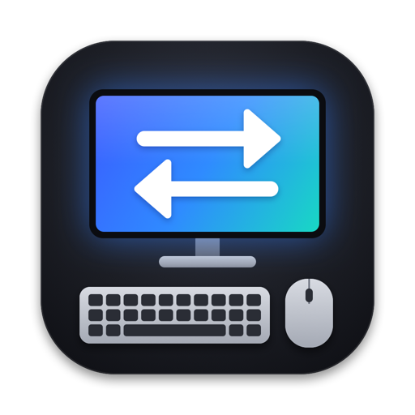

# MacMXSwitch

A small macOS menu bar app that hands your desk over to another computer in one go:

- switches the **Logitech MX Keys** and **MX Master 4** (Bluetooth) to another Easy-Switch channel,
- switches the external **monitor** to another input over DDC/CI.

## Requirements

- macOS 13 or later on Apple Silicon (the DDC code relies on Apple Silicon display services)
- Logitech MX Keys and/or MX Master 4 paired over **Bluetooth** (not the Bolt/Unifying receiver)
- An external monitor that supports DDC/CI input switching. Some USB-C hubs and docks don't pass DDC through; if
  `m1ddc get input` fails, the app can't switch the monitor either.

## Install

Download `MacMXSwitch-<version>.zip` from [Releases](https://github.com/mironiasty/mac-mx-switch/releases), unzip,
and move `MacMXSwitch.app` to `/Applications` or `~/Applications`. Release builds are signed with a Developer ID and
notarized by Apple.

The first time it runs, allow **Bluetooth** when macOS asks. No other permission is needed.

## Build from source

Needs Xcode Command Line Tools (`swiftc`).

```sh
./build.sh
```

This builds an ad-hoc signed `MacMXSwitch.app` (bundle ID `asia.miron.macmxswitch`), installs it to
`~/Applications`, and restarts it if it was running. Because the build is ad-hoc signed, macOS may ask for Bluetooth
again after a rebuild. For signed releases, see [RELEASING.md](RELEASING.md).

The app icon is drawn by `scripts/make-icon.swift`; after changing it, run `scripts/make-icns.sh` to regenerate
`Resources/AppIcon.icns` and `docs/icon.png`.

## Use

Open **MacMXSwitch** and it stays in the menu bar. The menu has:

- **Switch to …**: switches now, with the target shown in the title.
- **Logitech channel**: 1, 2 or 3.
- **Switch monitor**: on/off, and **Monitor input**: HDMI 1/2, DisplayPort 1/2, USB-C or a custom value.
- **Check devices**: reports current channels and input without switching.
- **Open at login**: starts MacMXSwitch with your Mac (listed under System Settings > General > Login Items).
- **Open log**, **About MacMXSwitch**, **Quit**.

Choices are saved. Opening the app again while it runs (Spotlight, Finder, or a Shortcuts "Open App" hotkey)
switches right away. Nothing appears on success.

It checks every device first. If the keyboard or mouse can't be reached, nothing is switched. If only the monitor
can't be switched, it asks whether to switch the keyboard and mouse anyway (Cancel is the default). Results are
written to `~/Library/Logs/MacMXSwitch.log`.

### Command line

For a one-off run without the menu bar, pass options (these ignore the saved menu settings). Use `open -n`: without
it, if the menu bar app is already running, `open` just reopens it, which switches with the saved settings and
ignores the options.

```sh
open -n ~/Applications/MacMXSwitch.app --args --host 2 --input 15
# or, to see output and answer prompts in the terminal:
~/Applications/MacMXSwitch.app/Contents/MacOS/MacMXSwitch --host 2 --input 15
```

| Option           | Meaning                                         |
| ---------------- | ----------------------------------------------- |
| `--host N`       | Easy-Switch channel to switch to (default 1)    |
| `--input N`      | Monitor input to switch to (default 17)         |
| `--no-monitor`   | Switch only the keyboard and mouse              |
| `--monitor-only` | Switch only the monitor                         |
| `--dry-run`      | Only report current channels and input          |

Common monitor inputs: `15` DisplayPort 1, `16` DisplayPort 2, `17` HDMI 1, `18` HDMI 2, `27` USB-C. They vary by
monitor; **Check devices** (or `--dry-run`) shows the current one.

## How it works

- **Keyboard and mouse**: HID++ 2.0 feature `0x1814` (Change Host), sent over Logitech's own BLE GATT
  characteristic (`00010001-0000-1000-8000-011f2000046d`). Frames are 18 bytes: feature index, function/software
  id, parameters. macOS refuses HID output reports to keyboards, so the IOHID route is only a fallback (and needs
  Input Monitoring).
- **Monitor**: DDC/CI VCP `0x60` (input source) through the private `IOAVService` I2C functions on Apple Silicon,
  the same approach as [m1ddc](https://github.com/waydabber/m1ddc).

Supported product IDs are in `Peripherals.swift` (`0xB35B` MX Keys, `0xB042` MX Master 4). Other HID++ 2.0
Logitech devices with Easy-Switch can be added there.

## Disclaimer

Not affiliated with Logitech. "MX", "MX Keys", and "MX Master" are trademarks of Logitech.
